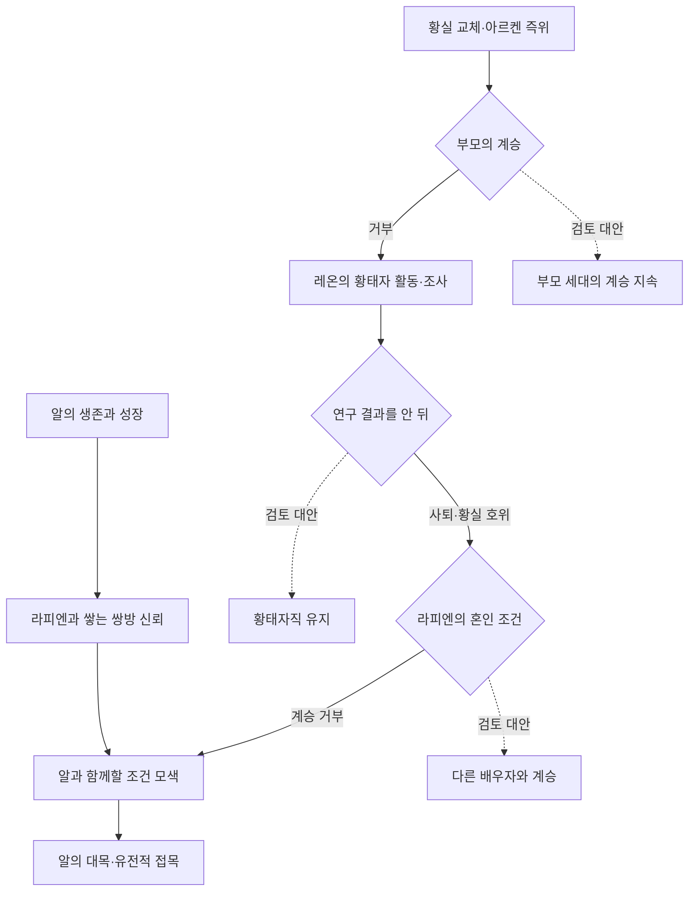

# 운명의 브랜치

## 교육과 임무의 연령 기준 — 2026-10-22

라피엔은 **본인 기준 10세에 귀족학교에 입학하여 14세에 통상보다 2년 빠르게 졸업**한다. **귀족학교 졸업과 사관학교 졸업·장교 임관은 동일한 사건으로 확정하지 않는다.** 기존 자유도시 안정화 작전의 준비 시점은 이 조건에 맞춰 집필하되, 최초 작전 실행 나이와 별도 군사교육의 정확한 경로는 열린 상태로 둔다.

알은 **10세 견습모험가**, **13세 초급모험가 시험 응시 가능**이다. 보육원에서의 사냥·훈련은 단순한 놀이가 아니라 장래의 모험가 경력과 연결된다. 초급 시험의 합격 및 정식 승급 시점은 미정이다. **알과 라피엔의 나이 차는 아직 확정하지 않는다.**

---

## 2026-10-22 확정 설정 보정 — 황실·북부·계승

> 이 절의 최신 사용자 확정 사항은 이 문서에 남아 있는 이전 요약·미정 표기보다 우선한다. 기존 서사에서 확정된 알의 대목(Rootstock)·라피엔 유전자 접목·사랑의 아이와 레온의 황실 호위 선택은 유지한다.

- **황실 테러:** 기존 황제·황후·황태자 세 명은 **같은 테러**로 사망했다. **북부 급진파가 직접 통제하는 그림자 황실**이 기획·실행했으며, 제국의 초정밀 마력회로 기술 우위 확대를 저지하려 했다. 황태자 선포 당일 연구 메모리의 북부 전달이 실패했고 메모리는 **행방불명**이다. 이는 초정밀 마력회로 **제작 기술의 유출**과 별개다.
- **가족과 계승:** 사망한 황제의 동생이자 황실 차남 용병단 지휘자였던 **아르켄**이 즉위했다. **아르켄의 아들**이 레온·라피엔의 아버지이자 당시 황태자이고, 남매의 어머니는 황태자비다. 과거 첫째가 완전형질·둘째 이후 열화라는 황실 혈통의 일반적 경향이 있었으나, **첫째 레온보다 둘째 라피엔의 유전적 결함이 적고 구시대 유전형질이 다수 발현**되었다. 장자 계승은 성별과 무관하며 차남 계열은 황실 호위·차남 용병단과 연결된다.
- **북부 초지성체와 외가:** 북부의 인공수정 전통을 떠난 황실 조상들은 사랑에 따른 출산을 선택했다. 급진파는 라피엔 **외가 혈통에 여러 세대에 걸쳐 개입**했다. 아버지는 아내의 유전자 개조 사실만 알고 급진파의 장기 개입·위성국가 계획은 모른다. 급진파의 목적은 자유도시 지배가문에 혼인·혈통 침투를 통해 장기 연구용 **독립 위성 통합국가(제국 또는 공화국)**를 형성하는 것이다. **북부 정통파는 개입을 의심하지만 증거가 없다.**
- **조직:** 북부 조사병단은 탐사·위험 개체 사냥을 담당하는 **정규군**이다. 그 안에 별도의 **황실 직할 특무조사기관**이 있어 정보수집·회수·잠행작전·특수임무를 수행한다. 전체 조사병단을 비밀기관으로 바꾸지 않는다.
- **생물학 연구:** 황제가 수행하는 연구는 **기억형 마력회로**로 저장되어 북부에서만 제조하는 인공수정 배양액의 수정확률·정밀도를 개선한다. 북부 출신 신부가 황실로 시집올 때 **이전 황제의 연구 성과를 가져와 계승**하기도 한다. ‘이저뉴’는 **‘이전’의 오타**이며 인물 이름이 아니다. 아르켄은 연구를 포기한 것이 아니라 아들 황태자에게 **연구 책임을 이관**했다.
- **북부 발견:** 아버지는 특무조사기관·조사병단, 위험을 무릅쓴 비행선 수색에도 북부의 존재를 찾지 못했다. 왕립 동물원의 **와이번 사육기록**을 추적해 와이번으로 이동했지만 실패했다. 왕가 서고에서 **빈 신호마법서**를 발견하고 **알과 라피엔**에게 추적·회수시켰다. 와이번 위에서 회수한 책의 마법을 시전하자 아버지는 **기절**, 와이번이 북부의 숨겨진 장소로 데려갔다. 그곳에서 **북부 정통파 초지성체**와 만나 **할아버지 시대의 메모리·구시대 메모리 2개**를 받아 돌아왔으며, **큰아버지인 선대 황제의 실종 메모리**는 회수하지 못했다.
- **연구 결과와 선택:** 아버지는 **라피엔에게 구시대 형질이 다수 발현**, **아내에게 구시대 유전형질이 강하게 잔존**함을 밝혀냈으며 연구를 마친 뒤 **라피엔에게 직접 설명**했다. 초정밀 회로 기술 유출로 **새로운 제국 선포를 유예**하고 **황가와 북부의 관계 복원(왕가의 밀약 갱신)**을 지향했다. 그러나 결정권을 자녀 세대로 넘겨 **먼저 레온에게 황태자 지위와 선택권을 주고, 이어 유전적 결함이 더 적은 라피엔이 황태자가 되어 선택**하도록 한다.
- **미확정 경계:** 밀약이 실제로 갱신됐는지, 황태자 승계의 법적 절차, 정통파가 의심을 어디까지 아버지에게 전했는지, 신호마법서의 작동 원리, 북부에서 들은 모든 설명의 내용은 확정하지 않는다. ‘라피엘’·‘초인’ 대신 **라피엔**·**초지성체**를 사용한다.

### 확정 사건 순서에 따른 장면 재배열 기준
아버지의 북부 존재 의심 → 황실 직할 특무조사기관·조사병단·비행선 수색 실패 → 와이번 사육기록 특이점 → 와이번 수색 실패 → 빈 신호마법서 → 알·라피엔의 회수 → 와이번 위 시전·실신·이동 → 북부 정통파 접촉 → 할아버지 시대와 구시대 메모리 회수 → 아버지의 연구 완료 → 라피엔에게 공개 → 레온 황태자 지위 계승과 선택 → 라피엔 황태자 지위 계승과 선택. **실제 회차 배치**와 개별 장면의 묘사는 미정이지만 **인과관계는 확정**이다.

---

> 집필 구상 v0.1 · 2026-10-21  
> 범위: 선택의 갈림길, 주요 장면, 초반 회차 배치, 정보 공개와 감정 회수.  
> 작가용 문서: 후반의 계승·연구·접목 결말을 포함한다.

## 1. 구상의 중심

**한 인물의 선택이 다음 인물에게 어떤 가능성을 열고, 어떤 부담을 남기는지를 장면으로 연결한다.** ‘운명의 브랜치’는 한 시간선 안에서 인물들이 선택하는 길과 선택하지 않은 삶을 추적하는 구성 원리다.

알은 아버지가 도시를 위해 자신과 알의 안전까지 걸었던 선택의 후과 속에서 자신의 이름과 삶을 되찾으려 한다. 황실에서는 계승을 거부하거나 역할을 바꾸는 선택이 이어진다. 두 흐름이 **라피엔에게 요구되는 혼인 조건**에서 만나고, 사랑하는 사람을 지탱하려는 알과 그와 함께할 삶을 원하는 라피엔의 갈등으로 깊어진다.

독자가 따라갈 중심 질문은 다음과 같이 커진다.

**알은 이곳에서 살아갈 수 있는가 → 누군가와 함께 살아갈 수 있는가 → 그 함께할 삶을 스스로 선택할 수 있는가.**

### 1.1 작품의 운명 철학 — 확정·발언

**운명 역시 하나의 선택이다.**

우리는 그것이 어디로 데려갈지 알지 못한 채 손을 내밀고, 때로는 독이 섞여 있다는 걸 알면서도 그 선택을 달콤하게 받아든다.

이 문장은 작품 전체의 선택 구조를 관통하는 주제로 적용한다. 아버지는 도시를 위해 남는 길을 택하고, 레온은 황태자직에서 물러나 호위의 자리를 택하며, 라피엔은 알을 포기하는 계승을 거부한다. 알 역시 마지막에는 대목이 되는 선택 앞에 선다.

다만 **다가온 사건 자체와 그 사건에 대한 인물의 선택은 구별한다.** 아버지의 죽음, 알의 보육원 생활, 라피엔과의 첫 만남처럼 스스로 고르지 못한 사건이 존재한다. 작품이 말하는 운명은 그런 사건을 모두 자유의지로 바꾸는 것이 아니라, 다가온 것 앞에서 어떤 사람이 될 것인지를 선택하는 데 있다.

알과 라피엔의 첫 만남에는 이 철학을 가장 감각적으로 각인한다.

> 그 만남이 독약이었다 해도 좋았다.  
> 나는 이미, 기꺼이 삼키고 있었으니까.

이 문장은 **[확정·발언]**으로 관리한다. 라피엔과의 만남이 실제로 해로운 관계라는 뜻이 아니라, 훗날 황실·전쟁·희생·대목의 운명까지 감당하게 될 것을 회고하는 비유다. 특히 ‘기꺼이’는 다가온 만남을 알이 자기 삶의 선택으로 받아들이는 지점을 뜻한다.

### 문서의 상태와 역할

- **확정 기반:** 사용자가 정한 사건·관계·선택. 각 절에서 따로 표시한다.
- **장면 제안:** 여기서 새로 구성한 행동, 대사, 소품, 사건의 배치와 반응. 채택 전까지 정사로 승격하지 않는다.
- **검토 대안:** 인물이 선택 전에 고려할 수 있도록 제안한 다른 길. 실제로 일어난 평행 세계나 별도 결말을 뜻하지 않는다.

브랜치와 장면의 상세 설계는 이 문서에서 관리한다. 메인 줄거리는 전체 흐름과 확정 사건을 관리하고, 제국사·인류사는 역사와 제도의 근거를 관리한다. 아래 도식·회차·대사·장면의 인과 연결은 모두 **집필 제안**이다.

## 2. 먼저 고정할 역사와 선택

| 구분 | 이미 정해진 내용 | 장면을 설계할 때 적용할 범위 |
|---|---|---|
| 황실 교체 | 기존 황실 일가의 테러 사망 뒤 황제가 교체됨. 아르켄의 옛 차남·대공 시절과 현 황제 재임은 기존 발언의 시점을 연결한 이력 | 이미 일어난 역사적 변화로 둔다. 아르켄의 자발적 즉위 동기나 생존 방법을 새로 정하지 않는다 |
| 두 황태자 시기 | 황제가 막 교체된 조인식 당시에는 라피엔의 아버지가 황태자. 후반에는 레온이 황태자로 활동 | 장면의 시기에 맞춰 호칭을 사용한다 |
| 부모 | 라피엔 출생으로 의무 완료. 부모는 황위 계승을 거부 | 출생에 따른 의무 완료와 실제 거부의 효력 발생 시점을 구별한다 |
| 레온 | 제국 문제를 하나씩 해결하다 이전 황실의 비밀 연구 결과를 알게 됨. 자신의 유전적 계승 부적합을 먼저 알고 스스로 황태자직에서 물러나 차남 역할의 황실 호위로 남음 | 남매의 계승 마찰을 유지한다. 차남 역할을 레온의 출생 순서로 바꾸지 않는다 |
| 라피엔 | 계승하려면 알 아닌 다른 사람과 결혼해야 하므로 황위 계승을 거부 | 상대·요구 주체·조건의 세부는 새 장면 구상과 확정 사실을 구별한다 |
| 두 사람의 소망 | 라피엔은 사랑하는 알과의 아이를 원함. 알은 그녀의 성장을 위한 튼튼한 뿌리면 족하다고 여김 | 알에게도 자신의 바람을 드러낼 장면을 주며, 라피엔의 아이에 대한 소망을 황실의 후계 의무와 구별한다 |
| 결말 | 알이 대목(Rootstock)이 되고 라피엔의 유전자가 알에게 접목됨 | 접목의 효과·대가·실제 출산·최종 계승은 별도 설계한다 |

**현재 통치자는 아르켄이다.** 부모와 남매의 거부가 이어질 때 긴장은 후계 계획과 업무 분담의 불확실성에서 만든다. 황제가 사망·퇴위했거나 황좌가 비었다는 사건을 덧붙여 긴장감을 만들지 않는다.

## 3. 운명의 두 흐름

### 3.1 연결도 — 제안

실선은 권장하는 서사 연결, 점선은 선택 전에 보여 줄 수 있는 대안이다. 개별 거부·사퇴·접목은 확정이지만, 거부 뒤 의무가 자동으로 다음 사람에게 넘어가는 법이나 모든 대안의 제도적 가능성까지 확정하는 도식은 아니다.

### 3.2 열 갈림길

| ID | 장면의 질문 | 선택 전 보여 줄 대안 — 제안 | 확정 기반과 선택 뒤의 파장 |
|---|---|---|---|
| B-00 | 알의 아버지는 제국 편입 뒤 도시를 떠날 것인가, 영주로 남을 것인가 | 제국이 제안한 가족 이주를 받아 자신과 알을 지키기 / 영주가 되어 도시에 남기 | 자유도시의 제국 편입 조건으로 반드시 영주를 세워야 했고, 아버지는 그 자리에 앉으면 자신과 알이 무사하지 못할 것을 알았다. 제국의 이주 제안을 거부하고 남으며, 알까지 희생될 수 있음을 염두에 둔 선택은 확정. 구체적인 협상 조항·위협 주체·알에게 예상한 희생의 형태는 별도 확인 |
| B-01 | 알은 자신의 출신을 얼마나 드러낼 것인가 | 자신을 설명해 자존심을 지키기 / 신분을 감춘 채 당장의 관계를 만들기 | 신분 은폐·보육원 생활은 확정. 감추는 말과 행동에 작은 비용을 주는 장면은 제안 |
| B-02 | 볼모로 불린 알은 무엇을 자신의 몫으로 정할 것인가 | 강요된 속죄 설명을 되풀이하기 / 무엇이 사실인지 묻고 떠나기 전 자신의 말을 남기기 | 대표·볼모·제국행은 확정. 자유롭게 잔류할 수 있는 제도는 만들지 않고, 강제된 상황 안의 행동 선택을 설계 |
| B-03 | 알과 라피엔은 서로를 믿고 역할을 나눌 것인가 | 혼자 해결해 불확실성을 줄이기 / 상대 판단을 받아들이고 위험을 나누기 | 두 사람의 성장·로맨스와 납치 사건은 기존 기반. 구체적인 공동 행동과 구출 순서는 제안 |
| B-04 | 부모는 의무를 마친 뒤 어떤 삶을 택할 것인가 | 황태자 재임을 이어가는 삶 / 계승을 거부하는 삶 | 거부와 의무 완료는 확정. 자녀가 그 선택의 결과를 체감하는 장면을 추가 |
| B-05 | 레온은 현안을 해결한 뒤 남는 의문을 추적할 것인가 | 해결 성과를 마무리하기 / 해결 과정의 모순을 더 확인하기 | 문제 해결 중 이전 황실 연구를 알게 되는 흐름은 확정. 추적을 택하는 이유와 비용을 구체화 |
| B-06 | 부적합을 안 레온은 어디에서 의무를 이어 갈 것인가 | 황태자직을 유지하며 대응하기 / 황태자직에서 물러나 호위 역할을 맡기 | 자진 사퇴와 황실 호위 선택은 확정. 권력·개혁 수단을 내려놓는 비용과 남매 마찰을 장면화 |
| B-07 | 라피엔은 알을 제외하는 계승 조건을 받아들일 것인가 | 다른 배우자와 계승하기 / 계승을 거부하고 이후 문제에 대응하기 | 혼인 조건에 따른 거부는 확정. 거부 뒤에도 남는 사람·업무·후계 문제를 보여 줌 |
| B-08 | 알은 자신의 미래를 어떻게 말할 것인가 | 라피엔을 위해 감당할 몫만 말하기 / 자신이 바라는 삶까지 관계 안에 말하기 | 두 소망의 갈등은 확정. 둘의 합의 방식과 감정적 결론은 제안 |
| B-09 | 접목을 결정할 때 두 사람은 무엇을 확인할 것인가 | 가능하다는 답으로 서두르기 / 효과·한계·서로의 소망을 확인하고 선택하기 | 접목은 확정 도착점. 검증·동의·행동의 순서는 제안이며 실제 출산·정치적 해결은 별도 |

아르켄의 즉위는 이 열 갈림길의 **역사적 배경**이다. 선택권이 좁아진 사건과 당사자가 자유롭게 고른 행동을 분리해, 알의 볼모행이나 아르켄의 황제 교체를 손쉬운 양자택일로 연출하지 않는다.

### 3.3 라피엔의 선택 — 첫 장교 작전으로 자유도시를 고르다

**[확정·발언]** 제국의 군대 장교는 졸업 뒤 자신만의 작전을 입안하고 승인을 받아 직접 실행해 업적을 쌓아야 한다. 적국 침공, 점령, 치안 안정화, 보급로 확보 등 무엇을 선택하든 장교는 자기 이름으로 작전을 제안해야 한다. 그래서 사관생도들은 졸업 직전에 갑자기 작전을 정하는 것이 아니라, 학교 초기부터 자신이 맡을 첫 작전을 구상하고 필요한 지식과 경험을 쌓는다.

라피엔은 사관학교 초기에 **자유도시 안정화 작전**을 자신의 첫 작전으로 고른다. 이것은 알을 만나기 위한 사적 명분으로 시작된 것이 아니라, 제국에 편입된 뒤 폭동과 행정 불안이 남은 자유도시를 실제로 안정시키는 군사·행정 작전이다. 동시에 어린 시절 가족여행 중 강화식에서 보았던 또래의 아이에 대한 기억이 작전 준비 과정에 조용히 섞여 있다.

라피엔은 작전안을 준비하면서 병력 규모, 비행선, 보급, 현지 행정 협조, 작전 종료 뒤 인계까지 직접 계산한다. **준비하는 동안 자신도 모르게 콧노래를 흥얼거린다.** 본인은 이를 첫 작전을 준비하는 기대감 정도로 받아들이지만, 독자에게는 자유도시라는 장소가 라피엔에게 이미 단순한 과제 이상의 의미를 갖고 있음을 보여 주는 감정의 흔적이 된다.

레온이 초기 작전안을 거절한 이유도 작전 자체가 나쁘기 때문이 아니다. **라피엔이 첫 작전을 반드시 성공시키기를 바라기 때문에 성공 확률을 높이려는 검증**이다. 병력이 너무 적은지, 보급선이 끊기면 어떻게 할지, 현지 행정이 협조하지 않을 경우 무엇을 할지, 주민들이 제국군을 점령군으로 받아들이면 어떻게 대응할지 등을 계속 되묻고 수정하게 한다.

따라서 레온의 거절은 라피엔의 선택을 막는 장면이 아니라, 그 선택을 실제 작전으로 만들기 위한 형제 간의 훈련이자 신뢰다. 충분히 다듬어진 뒤 레온은 **작은 병단과 비행선 한 척**을 빌려준다. 라피엔은 지난 한 달 동안 직접 병단의 작전, 물자, 각종 서류 작업을 준비하고, 사관학교에서 배운 지식이 실제 사람과 도시를 움직이는 데 매우 유용하다는 사실을 체감한다.

이 선택의 감정적 핵심은 **“알을 만나기 위해 자유도시를 선택했다”가 아니라 “자유도시를 자기 첫 작전으로 선택했는데, 준비할수록 이상하게 즐거웠다”**는 데 있다. 그래서 현지에서 알을 발견했을 때 라피엔의 기쁨은 계획된 연애 행동이 아니라, 오랫동안 쌓여 있던 개인적 기억이 작전의 성공감과 겹치며 터지는 감정이 된다.

**운명 철학과의 연결:** 라피엔에게 자유도시는 어린 시절 우연히 스쳐 간 장소였지만, 장교가 된 뒤 그곳을 자기 첫 작전으로 다시 선택한다. 다가온 기억이 시간이 지나 **자신의 선택**으로 바뀌는 첫 사례다.

## 4. 초반 배치 — 1~10화 예시

**[회차 구성 제안]** 회차는 읽는 분량의 배치이며 열흘의 사건표가 아니다. 실제 훈련 기간과 나이는 별도다. 1~3화는 생활·관계·움직임의 재미를 각각 완결하고, 4~7화는 사냥과 훈련이 서로 다른 문제를 해결하도록 짧게 진행한다. 보육원 생활을 압축할 때도 필요한 시간 경과를 문장으로 보여 준다.

| 회차 | 현재 목표와 주요 행동 | 그 화에서 얻는 보상 | 다음 화로 이어질 질문 |
|---|---|---|---|
| 1. 낯선 잠자리 | 보육원에서 오늘 잘 자리를 찾는다. 알은 익숙한 대우를 기대하다가 직접 움직여야 한다는 것을 배운다 | 잠자리와 첫 대화 상대를 얻음. 낯선 규칙 앞의 자존심에서 짧은 웃음 | 아이들은 알을 어떤 사람으로 받아들일까 |
| 2. 기다리는 아이 | 한 아이가 추방된 부모에게 자기 근황을 전하려 한다는 장면을 둔다. 알은 자기 사정을 숨긴 채 그 아이의 작은 일을 돕는다 | 상대가 알에게도 실질적인 도움을 돌려줌. 일방적인 구제 관계가 되지 않음 | 알은 자신의 가족 이야기를 어디까지 말할까 |
| 3. 눈보다 늦는 손 | 토끼를 따라가지만 붙잡는 동작이 따라오지 않는다. 실패한 지점을 관찰하고 다시 시도한다 | 이전보다 가까이 접근하거나 한 동작을 개선. 허세와 현실의 차이에서 유머 | 보는 능력과 해내는 능력 사이를 어떻게 메울까 |
| 4. 닿지 않는 일격 | 사슴 사냥에서 무기와 정확한 동작의 한계를 겪는다. 위험한 추격을 멈추는 판단도 성장으로 둔다 | 자신에게 부족한 과제가 선명해지고 무사히 돌아옴 | 무엇을 고쳐야 같은 실패를 줄일까 |
| 5. 매단 짚단 | 양끝을 줄로 묶은 짚단을 매달아 돌칼로 찌르기·베기를 연습한다 | 날의 방향과 타점을 조절하는 작은 진전. 새 스승 없이 실패를 수정 | 연습에서 되는 일이 움직이는 대상에게도 통할까 |
| 6. 빗나간 다음 동작 | 짚단이 흔들릴 때의 거리·발놀림을 고친다. 반복 자체보다 수정 전후 차이를 짧게 보여 준다 | 몸과 도구를 함께 제어하는 첫 성취 | 익힌 동작을 실제 생활에 쓸 수 있을까 |
| 7. 함께 먹는 저녁 | 앞선 준비를 사용해 작은 먹을거리 확보나 생활 문제 하나를 실제 해결한다 | 함께 먹고 웃는 완결된 보상. 알의 취향·승부욕도 드러남 | 조금 편해진 생활을 계속할 수 있을까 |
| 8. 돌아온 이름 | 이후의 대표·볼모 지정 시점으로 넘어간다. 숨겼던 신분으로 다시 불리지만 그 이름에 제국행의 의무가 붙는다 | 신분 변화의 큰 전환. 알이 떠나기 전 스스로 고른 말·물건·약속 하나를 남김 | 되찾은 이름으로 무엇을 해야 하는가 |
| 9. 새로운 상대 | 라피엔과 서로의 판단을 처음 확인하는 장면을 배치한다 | 상대에 대한 첫 판단이 한 번 바뀜. 짧은 대화와 능력의 작은 인정 | 다음 위험에서 저 사람을 믿어도 될까 |
| 10. 함께 빠져나가는 길 | 공동의 위기에서 둘의 판단·행동이 모두 필요하도록 구성한다 | 두 사람의 기여로 당장의 위기를 넘김. 함께 움직일 이유를 얻음 | 신뢰가 생긴 뒤에도 각자의 신분이 관계를 허락할까 |

9~10화는 **첫 대면과 공동 행동의 기능을 배치한 안**이다. 만남·납치·조인식의 실제 선후가 정해지면 그 순서에 맞춰 옮긴다. 조인식 당시 아버지 황태자라는 역사와, 알의 아버지 사망 뒤 제국행이라는 흐름을 이 회차표만으로 같은 날의 사건처럼 묶지 않는다.

첫 사슴 사냥 성공을 7화의 필수 보상으로 고정하지 않는다. 토끼 포획과 사슴 사냥은 난도가 다른 과제다. 훈련 두 화에서 관계 변화나 새로운 판단이 생기지 않는다면 한 화로 합치고 다음 전환을 앞당긴다.

## 5. 반드시 살릴 주요 장면 — 제안

아래는 완성 원고가 아닌 장면 설계다. 새 대사와 소품, 조연의 행동은 모두 제안이다. 각 장면은 **당장의 목표를 해결하면서 관계나 다음 선택의 조건을 바꾸는 것**을 목표로 한다.

### S-00. 떠날 수 있었던 아버지가 남는 날

**연결:** B-00 · 알의 비극 이전에 놓이는 선행 운명 브랜치.

**[확정 기반]** 자유도시가 제국에 편입되려면 반드시 영주를 선택해야 한다. 알의 아버지는 그 자리에 자신이 앉을 경우 자신뿐 아니라 알도 무사하지 못할 가능성이 높다는 사실을 알고 있다. 제국은 가족이 도시를 떠나 안전한 곳으로 이주하는 선택을 제안하지만, 그는 이를 거부하고 남기로 한다. 이 결정에는 **알까지 희생될 수 있다는 가능성을 감수한다는 판단**이 포함된다.

이 장면의 핵심은 아버지를 순수한 희생자나 완전한 영웅으로 단순화하지 않는 것이다. 도시를 버리지 않겠다는 책임감과, 자신의 아들을 위험에 남겨 두는 선택의 잔혹함이 동시에 존재한다.

**장면 제안:** 제국 측은 감정적인 협박 대신 현실적인 선택지를 제시한다. 편입을 위해 현지 영주가 필요하지만, 기존 지도자가 그 자리를 맡으면 배신자와 제국의 앞잡이라는 원한을 모두 받을 수 있음을 경고한다. 가족 이주는 안전책으로 제시된다. 아버지는 위험을 몰라서가 아니라 알고도 거부한다.

> “도시를 떠나시면 가족은 보호할 수 있습니다.”  
> “내가 떠난 뒤에도 이곳 사람들은 남아 있겠지.”  
> “아드님도 남게 됩니다.”  
> “…알고 있소.”

위 대사는 장면 제안이며 확정 대사가 아니다.

**선택의 대가:** 아버지는 영주가 되어 도시를 안정시키는 책임을 떠맡지만, 자신과 알은 양쪽의 증오와 정치적 위험에 노출된다. 이후 아버지의 테러 사망과 알의 신분 은폐는 이 선택의 후과로 더 강하게 읽힌다. 다만 반란파의 실제 동기와 제국이 이후 알을 볼모로 삼는 과정이 아버지의 선택 당시 정확히 예견된 계획이었다고 추가 확정하지 않는다.

**후반의 감정 회수:** 알이 나중에 아버지의 선택을 알게 되면 질문은 “아버지는 옳았는가?”보다 더 개인적인 것으로 바뀐다.

- 아버지는 도시를 위해 나까지 희생할 수 있다고 생각했는가.
- 나는 아버지가 선택한 희생을 계속 이어 가야 하는가.
- 사랑하는 사람을 위해 자신을 뿌리로 내어주는 나의 선택은 아버지의 선택과 무엇이 다른가.

이 차이를 끝까지 유지한다. 아버지는 **알의 동의 없이 알까지 위험에 포함한 선택**을 했고, 후반의 알은 자신의 희생을 사랑이라고 여기더라도 라피엔과 함께 선택해야 한다는 문제에 부딪힌다. 이 대비가 B-08~B-09의 감정적 핵심으로 회수될 수 있다.

### S-01. 남의 식탁에서 자신의 말을 고르는 알

**연결:** B-01 · 초반 1~2화.

알은 배고픔보다 먼저, 예전처럼 누군가 자신을 알아보고 자리를 마련해 줄 것이라는 습관 때문에 멈춘다. 다른 아이가 말없이 자리를 조금 내어 준다. 알은 도움을 받았다는 것을 인정하기 싫어하다가 그 옆에 앉는다.

식사 중 집정관을 원망하는 말이 들리는 장면을 둘 수 있다. 알은 반박하고 싶지만, 자기 신분을 말할 수 없다. 아버지의 모든 동기를 이미 이해한 연설 대신, 삼킨 말과 이후의 행동으로 반응한다. 다른 아이의 분노가 곧 집정관 때문에 그 부모가 추방됐다는 사실을 뜻하지는 않는다.

**선택과 결과:** 알은 신분을 감춘 상태에서 오늘의 관계를 만든다. 독자에게는 알의 출신과 아버지의 죽음을 초반에 알려, 아이들이 모르는 사실 때문에 알의 작은 반응을 따라가게 한다.

**장면의 보상:** 한 끼와 잠자리가 해결되고 말 걸 수 있는 상대가 생긴다. 후반의 큰 비밀 없이도 ‘이 아이가 여기서 들키지 않고 살아갈 수 있을까’라는 질문이 남는다.

### S-02. 실패한 사냥 뒤, 스스로 바꾸는 동작

**연결:** B-01에서 B-02로 가는 성장의 바탕 · 초반 3~7화.

토끼를 따라가는 눈과 늦게 뻗는 손, 사슴에게 필요한 일격의 차이를 행동으로 보여 준다. 실패 뒤에는 같은 장면을 반복하지 않고 알이 고친 점을 다음 시도에 반영한다. 매단 짚단에 닿는 위치가 달라지고, 날이 비껴 나가는 횟수가 줄어든다.

아이들은 관객이나 제자로 정렬하지 않는다. 누군가는 소리가 시끄럽다고 불평하고, 누군가는 자기 일을 하다가 필요할 때만 알을 부른다. 알의 연습도 그들의 생활 안에 놓인다.

**선택과 결과:** 알은 한 번에 자신을 증명하려는 무리한 시도에서 벗어나, 할 수 있는 행동을 늘리는 쪽으로 움직인다. 한 차례의 작은 생활 문제를 해결해 실력이 관계 안에서 쓸모를 얻는다.

**장면의 보상:** 함께 먹는 저녁이나 동료의 짧은 인정. 고생의 의미를 후반까지 미루지 않고 초반에서 돌려준다.

### S-03. 숨기던 이름으로 불려 나가는 날

**연결:** B-02 · 대표·볼모가 되는 전환.

그동안 감춰야 했던 출신으로 알을 부르는 사람이 나타난다. 누구의 지시인지, 어느 직책인지 등은 기존 사건의 주도자를 정한 뒤 채운다. 알은 잠깐 예전 생활로 돌아갈 수 있다고 생각하지만, 설명을 들을수록 자신에게 요구되는 것이 무엇인지 드러난다.

**선택과 결과:** 볼모행의 강제성은 유지한다. 그 안에서 알은 전달받은 속죄 문구를 그대로 다른 아이들에게 말할지, 자신이 아는 만큼만 말할지 선택한다. 누군가를 안심시키려고 불확실한 귀환 날짜를 약속하는 행동은 피한다.

떠나는 장면에서는 알이 챙길 수 있는 평범한 물건이나 스스로 고른 한마디를 둔다. 이 선택이 친구들과의 관계를 남기고, 이후 알이 지키고 싶은 삶의 구체적인 내용이 된다.

**다음 파장:** 독자는 ‘신분 회복’이라는 기대가 어떻게 새로운 의무와 결합하는지 경험한다. 알이 누구의 말로 자신의 삶을 설명하는지가 이후 로맨스와 접목 선택까지 이어진다.

### S-03A. 콧노래가 섞인 작전계획서

**연결:** 라피엔의 선택 §3.3 · 알과 재회하기 전.

라피엔이 자유도시 안정화 작전안을 여러 차례 고쳐 쓰는 장면을 둔다. 지도와 보급표, 비행선 적재량, 현지 행정 협조 절차가 책상 위에 쌓인다. 라피엔은 계산이 맞아떨어질 때마다 자신도 모르게 콧노래를 흥얼거리고, 어느 순간 그 사실을 깨닫지만 이유를 깊이 파고들지 않는다.

레온은 초안을 읽고 작전 자체를 부정하지 않는다. 대신 성공하지 못할 가능성을 하나씩 짚는다. 라피엔이 짜증을 내더라도, 질문에 답할수록 계획은 실제 작전으로 단단해진다.

> “안 돼.”  
> “작전이 나빠?”  
> “아니. 그래서 더 제대로 해.”

위 대사는 장면 제안이다. 레온의 확정된 의도는 **라피엔이 반드시 성공하기를 바라 성공 확률을 높이는 것**이다.

최종 승인 뒤 라피엔은 작은 병단과 비행선 한 척을 얻는다. 이때의 성취는 알과의 재회보다 먼저 독립적으로 완결한다. 그래야 자유도시 도착 뒤 알을 발견했을 때, 라피엔이 군인으로서 작전을 선택하고 성공시키려는 사람이라는 축과 개인적인 기쁨이 동시에 살아난다.

### S-04. 한 사람의 판단만으로는 빠져나갈 수 없는 순간

**연결:** B-03 · 라피엔과의 첫 공동 행동.

둘이 같은 위험을 보고 서로 다른 부분을 알아차린다. 알은 가까운 장애물이나 이동 가능한 틈을 보고, 라피엔은 자신의 경험으로 판단할 수 있는 다른 위험을 짚는다. 세부 장소·적·능력은 실제 납치와 만남의 순서에 맞춰 정한다.

**선택과 결과:** 한 사람이 상대를 지시하는 데서 끝내지 않는다. 알이 제안한 행동을 라피엔이 수정하고, 그 수정 덕분에 행동이 이어지며, 마지막 실행에는 알의 앞선 연습이 쓰이게 한다. 한쪽이 빠지면 같은 결과에 도달하지 못하는 장면으로 구성한다.

**장면의 보상:** 위험을 넘긴 뒤에는 서로의 착각을 짚는 짧은 웃음이나 실수를 수습하는 시간이 온다. 곧바로 다음 위기로 덮지 않고, 두 사람이 함께 있는 재미를 독자에게 준다.

### S-05. 왕좌 옆의 자리와 부모의 선택

**연결:** 역사적 배경 · B-04.

현재 황제 아르켄을 먼저 보여 주고, 그가 원래 황실의 차남이었다는 사실은 현재의 호위 업무와 연결되는 순간에 짧게 밝힌다. 왕좌 옆을 지키는 자리와 통치하는 자리를 시각적으로 대응시키되, 아르켄의 생존 경위나 즉위 당시의 속마음을 새로 만들어 회상하지 않는다.

부모의 거부는 별도의 가족 장면으로 둔다. 조인식 당시 아버지의 황태자 시절과 실제 거부가 일어나는 시점을 먼저 맞춘다. 부모가 의무를 마쳤다고 말한 뒤, 자녀 세대에 남은 후계 문제를 같은 대화 안에서 피할 수 없게 한다.

**대사 제안:**

> “우리의 의무는 끝났어.”  
> “그다음은 누가 정하나요?”

**선택과 결과:** 부모의 거부 이유를 무효화하지 않으면서 라피엔이 질문할 자리를 준다. 부모가 자녀에게 모든 비용을 떠넘길 의도로 출산했다는 내면은 확정하지 않는다.

**다음 파장:** 의무가 끝난 사람의 해방감과 새 문제를 마주한 사람의 불안이 한 장면에 함께 남는다. 새 황제가 필요한 무정부 상태가 아니라, 현 황제 아래에서 후계를 다시 계획해야 하는 문제다.

### S-06. 레온이 실제로 문제 하나를 해결하는 날

**연결:** B-05의 전반.

레온의 첫 주요 장면에는 눈앞의 성과를 준다. 예를 들어 독립 용병연대와 제국 사이에 계약 이행 문제가 생겨 출동이나 지원이 멈춘 현안을 사용할 수 있다. 이는 새 사건 제안이며, 계약의 구체 조항·미이행 주체·금액은 아직 정하지 않는다.

레온은 황태자라는 이유만으로 연대를 움직이지 않는다. 당사자들의 요구와 가능한 자원을 확인하고, 합의할 수 있는 범위를 찾아 당장의 피해를 줄인다. 알과 라피엔이 현장에 참여하는 배치를 택한다면 둘에게는 자기 역량 안의 별도 목표와 성과를 준다.

**선택과 결과:** 레온은 빠른 명령 대신 실제 이행 가능한 해결을 택한다. 한 문제가 해결되고 당사자들이 움직이기 시작하는 결과를 장면 안에서 보여 준다.

**다음 파장:** 독자가 먼저 ‘레온이 제국을 맡으면 좋겠다’고 기대할 근거를 얻는다. 뒤의 사퇴가 이미 부적합해 보이던 후보의 탈락으로 읽히지 않도록 한다.

### S-07. 해결된 사건 뒤에 남은 기록

**연결:** B-05의 후반에서 B-06의 직전.

레온이 제국의 문제를 해결하는 과정에서 이전 황실의 기록에 닿게 한다. 모든 현안에 같은 비밀을 숨기기보다, 앞선 문제 하나는 완결하고 이후 별개의 현안에서 기록 접근의 계기를 만드는 배열을 권한다.

조사는 세 장면으로 나눈다. 첫 장면에서는 당시 설명과 실제 처리 기록 사이의 불일치만 확인한다. 다음 장면에서는 기록의 출처와 연구의 존재를 확인한다. 마지막 장면에서는 자신의 계승 적합성과 관련된 결과를 검토한다. 어떤 수치·표지·실험이 부적합을 증명하는지는 연구 설정이 정해진 뒤 채운다.

**선택과 결과:** 레온이 더 확인하는 이유를 당장의 업무 책임에서 찾는다. 우연히 비밀 문을 열어 결말을 통째로 얻는 장면보다, 조사할수록 자신에게 불리해지는 답을 멈추지 않고 확인하는 행동에 무게를 둔다.

**정보 공개:** 레온이 답을 아는 시점의 밀착 시점을 택한다면 그의 생각만 부자연스럽게 가리지 않는다. 그 시점에는 핵심을 독자도 알게 하거나, 검증 중인 범위가 어디까지인지 명확히 쓴다.

### S-08. 황태자의 자리를 떠나 호위의 자리로

**연결:** B-06.

연구 결과를 확인한 뒤 레온이 사퇴를 결정하는 장면과, 그 선택을 실제 직무 변화로 보이는 장면을 나누어 둔다. 첫 장면에서는 자신이 추진하던 일과 사용할 수 있었던 권한의 상실이 드러난다. 다음 장면에서는 황태자의 자리에서 물러나 왕실을 지키는 역할을 택한 행동이 보인다.

호위의 정확한 공식 직함이나 임명 의식 대신, 장면 속 서 있는 위치와 맡는 행동으로 변화를 표현한다. 아르켄의 과거 역할과 시각적으로 연결되지만 두 사람의 동기까지 같다고 설명하지 않는다.

**남매 마찰의 장면 제안:** 라피엔은 레온의 유전적 판단을 이해하는 것과 자신에게 남는 부담을 받아들이는 것이 다른 문제임을 말한다. 레온은 그녀의 항의를 동생의 미성숙으로 처리하지 않는다.

> 라피엔: “오빠가 내려놓으면, 내게는 무엇이 남아?”  
> 레온: “그걸 네 대신 정할 생각은 없어.”

**다음 파장:** 레온은 사퇴 뒤에도 담당 업무와 사람을 책임지는 행동을 이어 간다. 사퇴로 계승 갈등과 제국의 모든 현안이 동시에 끝나지는 않는다.

### S-09. 라피엔이 혼인 조건을 거절하는 자리

**연결:** B-07.

계승을 받아들이면 얻을 수 있는 힘과 책임을 구체적으로 보여 준 뒤, 그 조건이 알과의 미래를 제외한다는 사실을 드러낸다. 다른 배우자를 자동으로 악인이나 열등한 인물로 만들지 않는다. 상대가 누구든 라피엔이 고르는 삶의 문제로 남긴다.

**선택과 결과:** 라피엔은 알이 자신을 위해 떠나거나 대신 거절하도록 기다리지 않고 자기 의사를 말한다. 그 뒤 회의나 협의가 즉시 끝나지 않도록 한다. 남아 있는 후계 계획과 자신이 맡은 일을 어떻게 처리할지는 다시 답해야 한다.

**장면의 보상:** 라피엔이 자기 삶을 분명히 선택한다. **비용:** 그 선택으로 모든 사람의 걱정과 반대가 사라지지는 않는다. 정확한 직위 박탈·추방·기한 같은 처분은 추가 설정 없이 확정하지 않는다.

**다음 파장:** 알은 그녀의 선택을 기쁘게만 받아들이지 못할 수 있다. 자신이 장애물이 되었다는 불안과 그녀가 스스로 선택했다는 사실을 어떻게 함께 받아들이는지가 다음 감정 장면을 만든다.

### S-10. 도움을 돌려받는 알

**연결:** B-03의 성장에서 B-08로. S-09보다 앞서 충분히 배치할 관계 장면.

알이 다른 사람의 준비를 살피느라 자기 몫을 뒤로 미루는 작은 행동을 한 번 보여 준다. 동시에 먹고 싶은 것, 이기고 싶은 승부, 쉬고 싶은 마음도 함께 드러낸다. 그는 처음부터 아무 욕망이 없는 희생자가 아니다.

다음 장면에서는 라피엔이 알의 상태를 보고 자기 일정이나 편의를 조정한다. 말로 고마워하는 데서 그치지 않고 상대를 위해 실제 비용을 쓰는 선택이다. 알은 그 도움을 받는 동안 자신이 무엇을 좋아하는지 말할 기회를 얻는다.

**장면의 보상:** 둘만 아는 취향과 습관이 생긴다. 독자는 라피엔이 왜 알과 함께 살고 싶은지, 알이 왜 그녀의 성장을 돕고 싶은지를 일상에서 경험한다.

**뒤의 회수:** 후반에 알이 자기 몫을 통째로 지우려 할 때, 라피엔은 추상적인 희생 반대 대신 자신이 알고 있는 그의 작은 바람을 구체적으로 떠올릴 수 있다.

### S-11. 같은 미래를 말하고 있다고 생각했던 두 사람

**연결:** B-08. 충분한 신뢰 뒤에 배치.

라피엔은 사랑하는 알과의 아이를 바란다는 말을 생활의 구체적인 그림 안에서 꺼낸다. 아이가 어떤 능력을 이어받을지보다, 둘이 어떤 일상을 나눌지에 관심을 둔다. 알도 따뜻하게 반응하지만 자신이 마련할 것과 감당할 것부터 말한다.

라피엔이 알 자신의 바람을 물으면, 알은 그녀가 잘되면 된다고 답한다. 그 대답은 사랑에서 나왔기에 곧바로 잘못으로 몰아붙이기 어렵다. 두 사람이 서로를 이해한다고 믿었던 순간에 서로 다른 미래를 보고 있었다는 사실이 드러난다.

**대사 제안:**

> 라피엔: “네가 해 줄 일 말고. 네가 하고 싶은 건?”  
> 알: “……그건 나중에 생각해도 되는 줄 알았어.”

**선택과 결과:** 대화를 한 번에 해결하지 않는다. 이후의 행동에서 알이 자기 바람을 말하는지, 라피엔이 그의 자발적인 헌신을 존중하면서도 함께할 미래를 요구하는지를 확인한다.

### S-12. 접목의 설명 앞에서 서로 다른 질문을 하다

**연결:** B-09 · 확정 결말의 직전과 실행.

접목의 가능성과 한계를 듣는 장면을 둔다. 설명하는 사람·기술·장소와 실제 비용은 관련 설정을 정한 뒤 채운다. 여기서 중요한 행동은 같은 정보를 들은 두 사람의 첫 질문이 다르다는 점이다.

알은 자신이 감당할 일을 묻고, 라피엔은 그 뒤 두 사람이 선택할 수 있는 삶을 묻는다. 이후 알이 대목이 되는 사건에 앞서 두 사람이 각자의 소망과 우려를 직접 말할 시간을 둔다. 조건이 확인되는 장면과 감정이 달라지는 장면을 모두 확보한다.

**확정 도착점:** 알이 대목이 되고 라피엔의 유전자가 접목된다.

**감정적 도착점의 우선 제안:** 알은 자신의 소망을 포함해 대목이 되는 선택을 말하고, 라피엔은 자기 바람을 말하면서 그의 선택과 비용을 함께 다룬다. 접목 후 갈등이 완전히 해소되는지 일부 남는지는 후속 결정이다. 실제 임신·출산·생존 형태·기억 변화·황위 문제의 해결을 이 장면만으로 추가하지 않는다.

**장면 회수:** 앞서 자기 몫을 뒤로 미뤘던 알이 이번에는 자기 몫도 말한다. 소박한 소망을 알고 있는 라피엔이 그 말을 기다린다. 초반의 돌칼 훈련은 전투·실행 능력의 성장으로 회수하고, 유전적 적합성을 증명하는 근거로 사용하지 않는다.

## 6. 레온의 조사와 알의 모험을 함께 움직이는 방법

**[배치 제안]** 레온의 현안 해결을 궁정 보고 장면으로만 처리하면 알의 이야기가 멈춘다. 각 사건에 서로 다른 역할을 준다.

| 장면의 층위 | 담당할 행동 | 독자가 얻는 것 |
|---|---|---|
| 현장 | 알·라피엔·동료가 현재 역량으로 사람·물건·경로 등 당장의 목표를 해결 | 모험, 협력, 성장의 성취 |
| 조정 | 레온이 당사자의 요구와 제국의 책임을 조정 | 통치 능력에 대한 신뢰 |
| 확인 | 해결 과정의 기록이나 진술에서 실제로 확인할 문제가 남음 | 다음 조사의 이유 |
| 다음 선택 | 새로 확인한 사실 때문에 인물이 기존 계획을 바꿈 | 비밀이 행동과 관계를 바꾸는 긴장 |

현장 참여는 알의 새 직책·군사 지휘권을 자동으로 부여하지 않는다. 레온의 발견을 알과 라피엔이 모두 동시에 알 필요도 없다. 장면에 참여한 인물이 실제로 관찰한 범위만 다음 행동의 근거로 쓴다.

모든 문제를 이전 황실 연구의 부작용으로 연결하지 않는다. 계약 이행 문제 하나가 해결되면 그 성과를 온전히 남긴다. 연구로 이어지는 현안에서는 **어떤 업무 때문에 그 기록을 확인해야 했는지**가 드러나도록 한다.

## 7. 먼저 보여 줄 것과 나중에 뜻이 달라질 것

### 7.1 복선과 감정 회수 — 제안

| 먼저 보여 주는 장면 | 처음의 의미 | 이후의 회수 | 추가로 확정하지 않을 것 |
|---|---|---|---|
| 보육원에서 숨기는 알의 신분 | 안전과 소속을 위해 말을 고름 | 같은 신분으로 대표·볼모 역할을 요구받는 S-03 | 신분을 아는 사람 전원의 명단 |
| 실패 뒤 동작을 바꾸는 연습 | 고집과 생활 능력의 성장 | S-04의 공동 행동에서 정확한 실행으로 기여 | 강한 몸이 곧 접목 적합성이라는 설명 |
| 알의 작은 양보와 분명한 취향 | 배려하면서도 자기 욕망이 있는 인물 | S-11~12에서 자기 몫을 말하는 문제가 됨 | 모든 헌신이 상처에서만 나온다는 해석 |
| 아르켄의 옛 호위 역할 | 황실의 역할 분담과 현재의 역사 | S-08에서 레온이 택하는 호위 역할과 대응 | 두 사람의 동기·상황이 동일하다는 설명 |
| 레온이 실제로 해결한 현안 | 유능한 황태자에 대한 기대 | 유전적 부적합이 드러나도 통치 능력의 성과는 남음 | 연구 결과가 전투력·통치 능력까지 부정한다는 설명 |
| 부모가 의무를 완료했다는 말 | 부모 세대의 결정과 해방 | 라피엔이 자기 삶을 선택할 때 가족의 말이 새롭게 들림 | 부모가 모든 후반 결과를 예측했다는 설명 |
| 라피엔이 알의 사소한 바람을 기억함 | 함께 지낸 시간의 친밀감 | S-12에서 그가 바라는 삶을 포함해 결정하도록 기다림 | 접목의 생물학적 효과나 출산 성공 |

### 7.2 질문을 바꾸는 순서

1. **초반:** 알은 새 생활에 적응하고 들키지 않을 수 있는가. 생활 문제와 작은 승리는 그 구간에서 답한다.
2. **첫 모험:** 알과 라피엔은 서로를 믿을 만한가. 함께 행동한 결과로 답한다.
3. **황태자 활동:** 레온은 제국을 이끌 수 있는가. 실제 문제 해결로 긍정적인 근거를 먼저 준다.
4. **연구 발견:** 능력과 계승 적합성이 다른 조건이라면 그는 어떤 자리에 남을 것인가.
5. **혼인 조건:** 라피엔은 어떤 삶을 택하며, 선택 뒤의 책임을 어떻게 감당할 것인가.
6. **접목 결말:** 두 사람은 무엇을 감당하고 무엇을 함께 누리기로 할 것인가.

새 질문은 앞선 행동의 결과에서 나온다. 한 화를 끝낼 때마다 모르는 이름·음모만 더하는 방식은 피하고, 작은 목표를 해결한 뒤 관계나 책임이 달라지는 지점에서 다음 화를 연다.

## 8. 집필 적용 순서

1. **초반 1~3화부터 장면화:** 잠자리·첫 관계·토끼 추적에 서로 다른 목표와 보상을 준다. 황실 역사와 유전자의 정답을 도입부에서 해설하지 않는다.
2. **이름의 전환과 첫 공동 행동 배치:** S-03·S-04를 실제 사건 연표에 맞춰 연결한다. 볼모행의 강제성과 그 안의 작은 선택을 함께 살린다.
3. **레온의 성과를 먼저 확보:** S-06의 현안을 한 번 완결한 뒤 S-07의 조사로 넘어간다. 조사에는 접근 이유·기록의 신뢰성·검증 범위를 둔다.
4. **부모·남매의 선택에 후속 장면 배정:** 선언 이후 실제로 무엇이 달라졌는지 한 장면 이상 보여 준다. 아르켄의 현재 통치와 후계 계획을 구별한다.
5. **쌍방의 일상을 충분히 축적:** S-10을 큰 정치적 거부 이전부터 배치해 S-11·12의 갈등에 구체적인 공동 경험을 준다.
6. **접목의 조건이 정해지면 필요한 근거를 앞에 배치:** 정답이 정해지기 전에는 특정 유전자·기술·복제품·기관을 해법으로 지정하지 않는다.

### 확인할 다섯 가지

- 장면의 중심 인물이 지금 원하는 것이 구체적인가.
- 그 인물의 행동으로 상황이나 관계가 실제로 바뀌는가.
- 다른 길에도 얻을 것이 있어 선택의 비용이 느껴지는가.
- 한 구간 안에서 성취·유머·친밀감 중 적어도 하나를 돌려주는가.
- 새 정보가 다음 행동을 바꾸며, 확정되지 않은 정답을 임의로 채우지 않는가.

## 9. 근거와 연결 문서

이 문서의 확정 기반은 2026-10-21까지 정리한 아래 자료와 이번 대화의 사용자 결정이다. 외부 소설의 장면이나 미확인 결말을 가져와 세계관의 사실로 적용하지 않았다.

- [메인 줄거리 및 개연성](https://github.com/ssj-sketch/fanta/blob/main/메인_줄거리_및_개연성.md): 알의 출발, 세 갈림길, 레온의 의무 수행, 대목 결말과 감정 갈등.
- [등장인물](https://github.com/ssj-sketch/fanta/blob/main/등장인물.md): 이름·관계·동기와 비밀의 확인 범위.
- [세계관 설정집](https://github.com/ssj-sketch/fanta/blob/main/세계관_설정집.md): 형질·혼인·계승, 황실 차남의 호위 업무, 독립 조직의 원칙.
- [제국의 역사](https://github.com/ssj-sketch/fanta/blob/main/history_empire.md): 황실 교체, 아르켄의 시기별 지위, 아버지와 레온의 두 황태자 시기.
- [인류의 역사](https://github.com/ssj-sketch/fanta/blob/main/history_humanity.md): 에덴·남하·황가 형질의 역사적 배경.
- [설정 변경이력](https://github.com/ssj-sketch/fanta/blob/main/설정_변경이력.md): 이번 분리와 집필 제안의 반영 범위.

---

## 10. 첫 번째 참사와 제국군 원수의 운명 — 알껍질을 깨는 브랜치

> **설정 상태:** 첫 의뢰의 실패, 특수모험가 길드의 괴멸과 해체, 동료들의 희생, 라피엔의 구조, 초정밀 마력회로 제작용 천공카드 유출, 자유연맹의 기술 보급을 통한 자유도시 결속, 그리고 **알이 개인·영지의 한계를 넘어 제국군 원수로 성장한다는 방향**은 최근 사용자 결정이다. 이 절의 작전 세부와 승진 경로는 **집필 제안**으로서 확정 연대·계급 절차와 구별한다. 이름은 기존 정사에 따라 **라피엔**으로 통일한다.

### 10.1 사건의 의미: 전능의 생존본능이 구할 수 없었던 사람들

알은 사관학교에서 사고를 목격하고 구조용 낙하산을 개발해 첫 제국특허를 얻었다. 졸업 뒤 영주 직속 특수모험가 길드를 만들어 여러 길드가 포기한 최고난도 임무를 맡는다. 겉으로는 보상과 명성을 좇는 모험사업이지만, 실은 **각국 모험가·자유도시·상단과 인적 네트워크를 만들고 황실의 고급 정보에 접근할 신용을 확보하려는 전략**이다.

그러나 첫 중대한 의뢰에서 그는 의뢰 내용의 난도와 현장의 위험을 분석했을 뿐, **그 의뢰를 누가 왜 자신에게 맡겼는지**라는 정치적 질문에는 충분히 답하지 못한다. 이 실패는 알의 전투능력 부족이나 생존본능의 무효화가 아니다. 개인이 생환하는 판단과, 타인의 의도를 읽고 공적 조직 전체를 보호하는 책임 사이의 간극이다.

알은 목표였던 최신 마력회로를 회수할 수 있다. 하지만 제조용 마스크의 형상 데이터를 담은 천공카드가 테러 때 함께 유출되었다는 사실은 이미 지나간 뒤다. 카드는 적에게 즉각적인 완제품을 주지 않지만, 숙련 기술자·설비·소재와 수년간의 복제 작업을 통해 제국의 전략적 독점을 무너뜨린다. **눈앞의 회수 성공이 역사적으로는 실패였음**을 뒤늦게 이해한다.

### 10.2 검은 트라이앵글과 암살의 주체를 혼동하지 않는다

[갈등의 축 — 빌런](갈등의축-빌런.md)에 기록된 **검은 트라이앵글은 북부 급진 연구집단·북부 조사병단·제국 황가** 사이의 실험체 폐기·위험 제거와 자료 회수·연구성과 수용이라는 **구조적 관계**다. 세 조직이 동일한 비밀 암살단이라는 뜻이 아니다. 급진 연구집단과 연결된 **그림자 황실은 북부 급진파가 직접 통제하며**, 과거 황실 일가 몰살 테러를 실행했다는 사실과도 구분해야 한다.

새로운 사건에서 **알의 제거를 지시한 구체적 실행망**은 급진파·그림자 황실 계열의 작전으로 배치할 수 있지만, 실무 가담 세력과 검은 트라이앵글의 조직별 인지 범위는 추리의 과제로 남긴다. 최근 논의한 **알과 라피엔의 결혼 저지**는 급진파 장기 목적에 대한 동기 제안으로 활용한다. 라피엔 어머니의 외가에 대한 다세대 유전 개입과 **연구용 위성 통합국가 구상**은 정사이며, 결혼을 막기 위한 구체적 발주·암살 명령 계통은 추가 증거가 드러나야 한다.

### 10.3 참사의 다섯 단계 — 제안

| 단계 | 독자가 보는 사건 | 알이 뒤늦게 알게 되는 것 | 누적되는 대가 |
|---|---|---|---|
| 1. 수주 | 제국의 고급 정보를 얻고자 최고난도 의뢰 수락 | 의뢰인이 자신이 움직일 경로와 전력을 미리 파악함 | 길드의 핵심 대원들이 한곳에 집결 |
| 2. 회수 | 최신 마력회로 확보에 성공 | 회로 원본보다 제조용 천공카드의 유출이 치명적 | 전략적 목표에 대한 오판 |
| 3. 함정 | 황실에만 존재한다고 믿은 신형 마력장비가 적에게서 등장 | 적은 수년간 복제품을 준비해 왔음 | 예상 밖의 피해, 지휘와 철수의 혼란 |
| 4. 탈출 | 대원들이 서로를 살리기 위해 시간을 벌고 라피엔이 고가의 공중중계 무전망을 활용해 구조 | 개인의 생존능력으로 전원의 생환을 보장할 수 없음 | 동료들의 죽음·부상·실종, 알의 생환 |
| 5. 후폭풍 | 특수모험가 길드 해체, 의뢰의 회수 실적은 기록으로 남음 | 보이지 않는 제조기술 유출과 외교적 도미노가 이미 시작됨 | 명성과 재산으로도 되돌리지 못할 상실 |

라피엔은 조난자를 찾고 구조망을 운용하는 **능동적 주체**여야 한다. 그 역시 모든 사람을 구하지 못한다. 장비의 엄청난 가격은 평상시 두 사람의 유머 소재였으나, 이 장면에서는 생존자들을 연결하는 값비싼 마지막 희망이 된다. 누가 죽거나 살아남는지, 누가 시간을 벌었는지, 임무의 정식 명칭과 장소는 별도 확정한다.

### 10.4 한 나라의 붕괴와 자유연맹의 통합 — 반드시 인과를 보여준다

특수 길드의 괴멸만으로 한 나라가 멸망하지는 않는다. **[집필 제안]** 알의 임무 실패가 특정 소국의 보안·외교 또는 전략시설을 지키는 마지막 연결고리를 끊는 사건이 되게 한다. 제국의 기존 군사 계획과 소국 내부의 취약성이 결합하면서 침공·국가 붕괴가 발생한다. 알에게 책임은 있지만, 그의 한 번의 실수가 단독으로 나라를 멸망시킨 것은 아니다.

그 멸망이 자유도시들에 공포와 분노를 퍼뜨린다. 각 자유도시는 제국에 맞서야 한다고 외치면서도 무기체계·지휘권·관세·병력 분담을 두고 갈라진다. 그때 급진파의 외부 영향망 또는 그와 거래하는 세력은 **복제 신형 마력회로의 공동 보급**을 제안한다. 기술은 군비 확충의 유인인 동시에 공통 규격·공동 조달·상호 방위를 강제하는 연결고리가 된다. 지도자들은 통합의 명분을 얻고 시민들은 제국군에 항전할 동기를 얻는다.

**서사적 역설:** 자유도시 주민의 자발적인 저항은 진실한 것이나, 통합의 일부 물적 조건은 장기적인 혈통 개입과 연구용 위성국가를 노리는 급진파의 목적에도 부합한다. 따라서 자유연맹을 구성하는 모든 시민·정부가 급진파의 공범은 아니다. 알이 제국에 충성하면서도 자유연맹 시민의 생존권을 존중해야 할 이유가 여기에 있다.

### 10.5 알의 내적 브랜치 — 영웅의 생존에서 원수의 책임으로

| 분기 | 알의 이전 답 | 참사 뒤 선택해야 할 새로운 답 |
|---|---|---|
| 생존 | 내가 현장에 가면 살아서 돌아올 수 있다 | **내가 없어도 부하가 돌아올 체계**를 만든다 |
| 조직 | 믿을 만한 소수 정예라면 어떤 의뢰든 해결한다 | 서로 다른 군단·해군·마도기술·정보기관의 실패까지 감당할 수 있는 공적 지휘를 배운다 |
| 영지 | 내 땅과 사람들이 안전하면 성공이다 | 다른 도시와 국경 너머의 주민들도 자신의 결정에 영향을 받는다는 사실을 인정한다 |
| 정보 | 인맥과 고급 기밀을 확보하면 앞설 수 있다 | 출처를 검증하고 반증을 찾으며 정보가 누락되었을 가능성을 제도적으로 심사한다 |
| 무력 | 나의 강함과 신기술이 전투를 바꾼다 | 대전략·정치적 목표·산업동원·보급·지휘권이 전쟁을 결정한다 |
| 책임 | 실패한 사람을 대신해 내가 더 위험한 곳으로 간다 | 실패를 기록하고, 권한을 나누고, 다른 사람이 자신을 제지할 수 있게 한다 |

**전환의 핵심:** 알은 동료를 잃었다는 죄책감 때문에 무조건 더 높은 권력을 좇지 않는다. 오히려 자신의 재산·영지·능력으로는 다음 참사를 막을 수 없음을 깨닫고, 황실의 권한 아래 **책임과 감사를 받는 제국 정규군의 지휘 체계** 안으로 들어간다. 그가 바라는 것은 계급장이 아니라 **같은 비극을 줄일 수 있는 규모의 책임**이다.

이 선택에는 비용이 있어야 한다. 영지의 독자 군수사업과 제국의 전략 요구가 충돌하고, 드워프의 권리와 군사기밀 사이에서 고민하며, 자신을 믿었던 유민들은 그가 또 다른 전쟁의 책임자가 되는 것을 두려워할 수 있다. 그가 보호하려는 사람을 군수물자처럼 취급하는 순간 스스로 비판했던 급진파의 윤리와 닮게 된다.

### 10.6 제국군 원수까지 가는 계단 — 지위가 아니라 증명

| 관문 | 외부 사건과 실적 | 치르는 대가·배우는 책임 |
|---|---|---|
| 길드 해체 뒤 | 희생과 작전 실패를 숨기지 않은 보고서 제출, 독립 조사 요청 | 황실·군부의 불신과 정치적 책임 |
| 첫 제국군 임무 | 기존 임관 자격을 근거로 제한된 정규군 지휘권을 받아 연합 구조·피란민 호송·정보 검증을 수행 | 용병과 영지 병력을 군 규율 아래 두는 고통 |
| 중견 지휘관 | 자유연맹 신형 회로의 보급 실태 분석, 공수·통신·증기 수송을 통합한 작전 수행 | 공적·실패를 다른 장교들과 공유하고 참모의 반대 의견을 수용 |
| 광역 전역 지휘관 | 여러 전선의 군단과 해군, 동원·병참·민간 보호를 조정; 눈앞의 승리보다 제국의 전쟁목표를 관리 | 자신의 영지에 불리한 결단도 받아들임 |
| 원수 임명 | 국가 존립의 위기에서 군사·외교·산업·민정의 이해를 조율하고, 제국군을 승리뿐 아니라 **전쟁을 끝낼 수 있는 상태**로 이끔 | 황권을 대신하지 않는 권력의 경계와 장기적 책임 |

제국군 원수는 알의 영지에서 만든 전함이나 낙하산만으로 얻는 자리가 아니다. 공적 심사, 전역 지휘의 신뢰, 다른 장성들의 수용, 국가의 임명 절차가 필요하다. **레온과의 친분만으로 승진하지 않는다.** 원수 임명의 시기·최종 전역·임명권자는 추후 연대기에 맞춰 확정한다.

### 10.7 시대정신: 누구를 위한 제국인가

알이 제국군 원수에 이르는 서사의 시대정신은 단순한 제국주의적 팽창도, 적국을 미워하는 개인적 복수도 아니다.

- 개인 전공에 기댄 전쟁에서 **산업·학문·정보·보급·조직이 결합된 전쟁**으로 바뀌는 시대를 이해한다.
- 제국 시민뿐 아니라 자유연맹의 피란민과 포로도 **명령의 결과를 감당하는 인간**임을 인정한다.
- 황가의 마도공학이 검은 트라이앵글의 비윤리적 실험 부산물에서 일부 비롯되었다는 진실을 외면하지 않는다. 신기술이 아무리 유용해도 연구 피해자를 지워서는 안 된다.
- 황제·황태자와 서로 다른 판단을 할 때, 충성은 무조건 동의가 아니라 **근거와 대안을 제시하는 책임**이라는 사실을 실천한다.
- 자신이 지킨 영지의 드워프·상인·연구자가 군대의 사유재산이 아님을 지키며, 국가에 헌신하되 권력과 도덕적 권한을 혼동하지 않는다.

**시대정신을 드러내는 결정적 역전:** 알에게 자유연맹 통합은 자신의 실패가 키운 적의 탄생이다. 그러나 그는 자유연맹의 시민까지 없애야 제국을 지킬 수 있다고 생각하지 않는다. 장차 원수로서 싸워야 할 것은 사람들의 생존 의지가 아니라, 그 의지를 군사와 생명 연구의 재료로 삼는 구조다. 이는 북부 급진파가 인간을 자원으로 보는 태도와 정면으로 충돌한다.

### 10.8 장면의 축 — 전투의 영웅이 아니라 패배를 책임지는 사람

**장면 A — 마지막 보고.** 부상자 명단을 다 읽은 알은 보고서의 표제에서 '목표 회수 성공'이라는 문구를 지운다. 회수품은 황실 창고에 있다. 하지만 부하의 이름은 복귀 명단에 없다. 그가 최초로 선택하는 것은 자신을 변호하는 성과 기록이 아니라 실패의 원인과 책임을 숨기지 않는 기록이다.

**장면 B — 영지의 회의.** 드워프 장인은 군수공방을 늘려야 한다고, 금융회사의 친구는 현금과 선박을 지켜야 한다고, 상단은 길을 닫으라고 말한다. 알은 누구도 틀리지 않았음을 안다. 그럼에도 자신의 영지를 지키는 선택만으로는 다른 나라가 무너지는 일을 막을 수 없었다. 그가 다음 세대의 장인들과 병사들에게 줄 수 있는 답은 더 비싼 장비가 아니라, **실패를 알려주고 반복하지 않게 할 제도**다.

**장면 C — 라피엔과의 대화.** 라피엔은 자신이 알을 구조한 영웅이라는 칭찬을 거절한다. 살아남지 못한 동료들의 이름도 알고 있기 때문이다. 그는 알이 다시 죽으러 갈 생각으로 군대에 들어가려 하면 반대한다. 하지만 책임질 사람을 더 넓게 보게 되었다면 그 선택을 함께 검토한다. 그녀는 그의 전쟁을 위한 보상이나 계승을 위한 혈통 자원이 아니라 독립된 연구자이자 정치적 행위자다.

**장면 D — 승리 뒤의 거절.** 원수의 길에서 알이 가장 크게 성장했음을 증명할 선택은 적을 몰살할 수 있는 기회를 거절하고 민간인이 탈출할 시간을 확보하거나, 명백히 비윤리적인 마도기술의 사용을 중단시키는 것이다. 이 선택은 전술적 비용을 초래해도 정치적 목적을 지키는 결정이 된다.

### 10.9 기존 브랜치·복선과 접속

- **B-00 ~ B-03:** 아버지는 아들과 도시의 위험을 알고도 영주가 되는 결정을 내렸고, 알은 보육원에서 살아남아 협력을 배운다. 첫 길드의 괴멸은 아버지의 희생을 반복하는 운명을 경계하게 만든다.
- **B-05 ~ B-07:** 레온의 공적과 사퇴, 라피엔의 계승 거부를 훼손하지 않는다. 원수의 알과 황실 호위가 된 레온은 제각기 국가를 지키는 방법을 선택한다.
- **S-10 ~ S-12:** 알이 자신을 무조건 소모하려는 성향을 가진다면, 라피엔과의 사랑은 단순한 위로가 아니라 **그 자신도 지켜야 할 삶을 가진 사람**이라는 반론이다. 마지막 대목·접목의 자발성과 쌍방 선택을 원수의 공적 희생 논리로 지워서는 안 된다.
- **황가의 신호마법서:** 알과 라피엔이 신호마법서를 찾아오는 사건과 **최초 의뢰 참사**의 시간적 관계는 별도 연표 검증 대상으로 남긴다. 두 임무를 동일 사건으로 합치거나, 신호마법서를 분실 마스크 천공카드로 바꾸지 않는다.
- **기술 유출 구분:** 옛 황실 일가 몰살 때 사라진 연구 메모리, 초정밀 마력회로의 제조용 천공카드, 현장 회수에 성공한 최신 마력회로는 서로 다른 물건이다. 각각의 회수 여부와 공개 시점을 구별한다.
- **연대 미확정:** 길드 창설·해체의 절대 연도, 붕괴한 소국의 정체, 레온의 직책별 시기, 자유연맹 통합의 단계, 알의 원수 임명 시점은 보류하되 인과와 감정적 결과를 먼저 확정한다.

> **새로운 운명의 질문:** “나는 살아남을 수 있는가?”에서 “내 사람들을 지킬 수 있는가?”를 거쳐, “내가 알지 못하는 사람들의 생존까지 책임질 수 있는가?”로. **알은 자기 영지와 전능의 생존본능이라는 알껍질을 깨고, 개인 영웅이 아니라 시대 전체의 위험을 감당하는 공적 지휘관으로 성장한다.**
